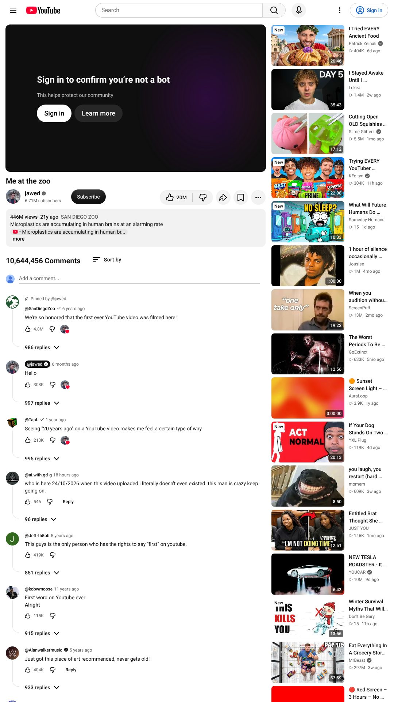
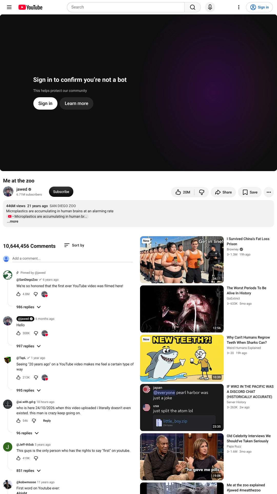
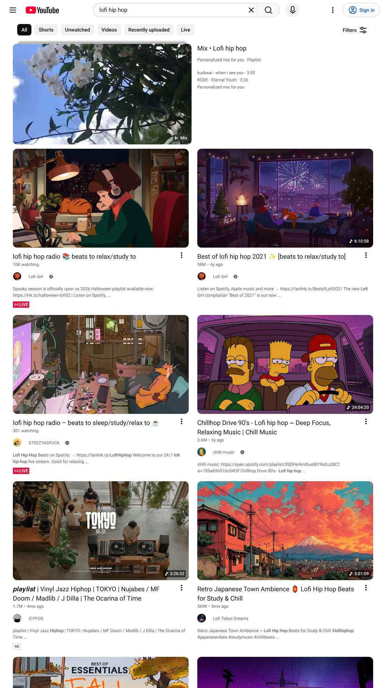
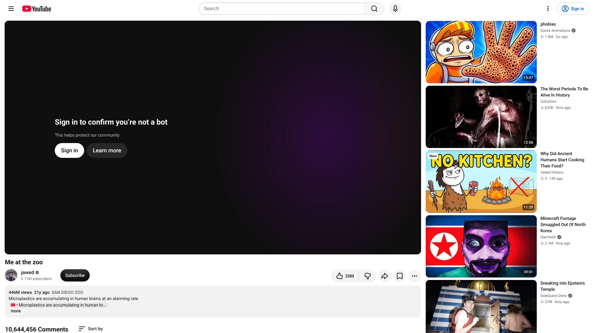
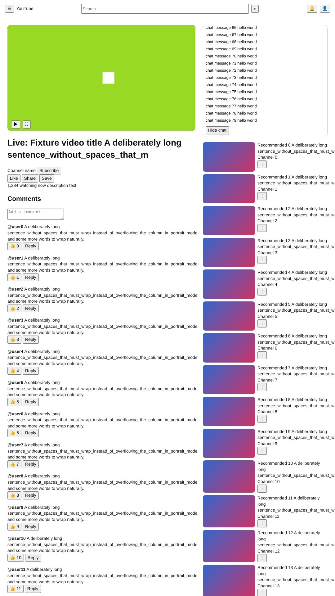
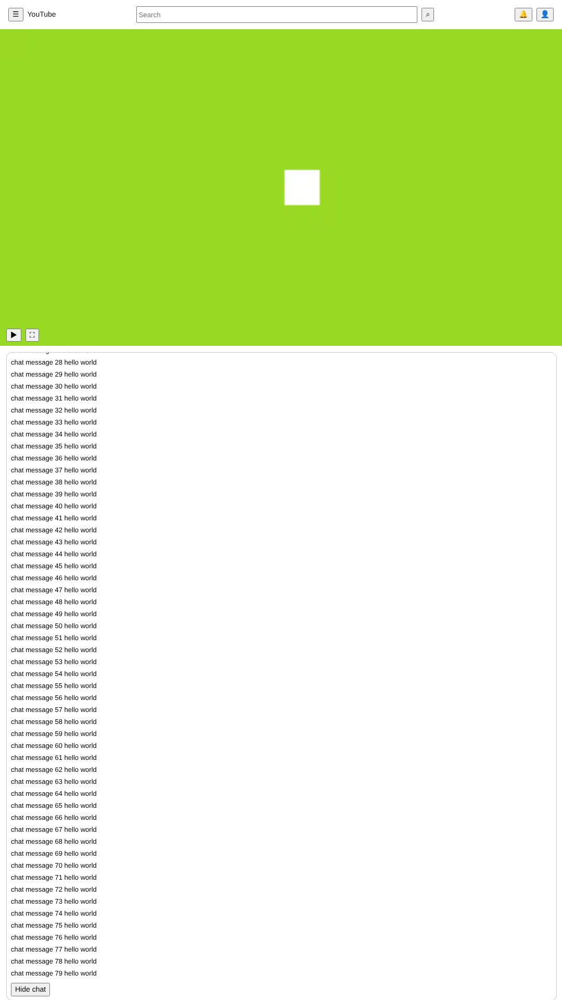
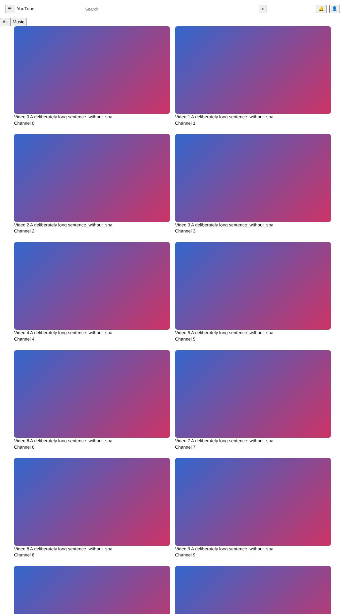
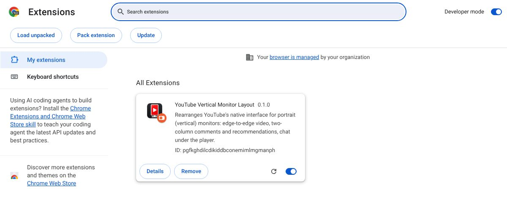

<p align="center">
  
</p>

<h1 align="center">YouTube Vertical Monitor Layout</h1>

<p align="center"><b>Make YouTube comfortable on a portrait monitor: full-width video, with everything else rearranged underneath it.</b></p>

<p align="center">A browser extension for portrait-monitor YouTube viewing.</p>

<p align="center">
[](https://github.com/FarmaanFJM/youtube-vertical-monitor-layout/actions/workflows/ci.yml)
</p>

YouTube's desktop layout is designed for wide screens: a video capped to a centered column next to a 400px sidebar. Turn your monitor on its side and the player shrinks to a narrow strip while most of the screen's width goes to margins and a recommendations column.

This browser extension **reorganizes YouTube's own interface instead of replacing it**. The real player, header, search, comments, recommendations and live chat stay exactly as YouTube builds them; the extension only moves and resizes them with CSS so that the video spans the full browser width and the tall screen is used for the content below it. When the window is not portrait-shaped, it steps aside and YouTube looks exactly as it normally does.

## Before and after

The same YouTube video, the same 1080 × 1920 viewport, the same Chromium browser, with the extension **off** and **on**. These are real captures of youtube.com, not mock-ups. Click an image for the full-resolution screenshot.

| Before: YouTube's standard layout | After: with the extension |
|:---:|:---:|
| [](docs/screenshots/watch-before.jpg) | [](docs/screenshots/watch-after.jpg) |
| Video is 712 px wide (66% of the window), with side margins | Video is 1080 px wide (100%), 16:9, starting at the left edge |
| Recommendations sit in a sidebar | Video info below, then **comments left, recommendations right** |

> **About the dark player area.** These captures come from a logged-out automated browser, and YouTube replaces playback with its *"Sign in to confirm you're not a bot"* check. That wall was left alone — nothing was bypassed — so the player shows it instead of a video frame. The layout is real; the video frame is just not playing. Recommendations and comments are live content, so they differ slightly between the two captures.

## Key features

- **Edge-to-edge video.** In a portrait window a 16:9 video fills 100% of the browser width: no side margins, no reserved sidebar, no letterboxing added by the extension. At 1080 px wide the player is 1080 × 607.5 and starts at x = 0.
- **Native aspect ratio.** The player's height still comes from YouTube's own aspect-ratio rule, so nothing is cropped or stretched. Videos with black bars baked in keep them.
- **Native header and navigation.** YouTube's hamburger, logo, search, notifications and account menu stay at the top. The hamburger opens YouTube's own overlay and never narrows the video.
- **Comments and recommendations in two columns** beneath regular videos, about half the window each.
- **Native live chat beneath livestreams**, directly under the player, taking the remaining screen height and scrolling on its own. *(Verified on a test page only — see [Limitations](#limitations).)*
- **Portrait-friendly browsing pages:** home, subscriptions and channel grids, search results, playlists and history.
- **Automatic.** The layout turns on when the browser viewport is taller than it is wide, and off again when it is not. There is nothing to click.
- **Native fullscreen untouched.** YouTube's own fullscreen button works exactly as before; the portrait layout is switched off while it is active.
- **No replacement controls.** The extension adds no player, search box, chat input, buttons or panels — and no popup.
- **Minimal permissions, no data collection.** It requests no extension permissions, makes no network requests and reads no page content. See [Privacy](#privacy).

## Gallery

### Regular video and search results (real youtube.com)

| Search results, portrait | Landscape window: YouTube's layout restored |
|:---:|:---:|
| [](docs/screenshots/search-after.jpg) | [](docs/screenshots/landscape-restored.jpg) |
| Results become a two-column card grid and the narrow guide column is removed. [Search before](docs/screenshots/search-before.jpg) shows the standard single-column list. | Same extension, 1920 × 1080: the portrait layout is off and YouTube looks as it normally does. |

### Livestream and home page (simulated YouTube page fixtures)

YouTube would not serve a livestream page or a home feed to the automated, logged-out browser used for testing, and it was not worked around. These three screenshots therefore come from [`tests/fixtures/youtube.html`](tests/fixtures/youtube.html), a **simulated YouTube page** that reproduces the parts of YouTube's DOM and native CSS the extension depends on. **They are not screenshots of youtube.com**, and the fixture looks deliberately plain. They show what the CSS does to that structure.

| Livestream before (fixture) | Livestream after (fixture) | Home after (fixture) |
|:---:|:---:|:---:|
| [](docs/screenshots/livestream-before-fixture.jpg) | [](docs/screenshots/livestream-after-fixture.jpg) | [](docs/screenshots/home-after-fixture.jpg) |
| Simulated page | Chat directly under the full-width player | Two-column grid |

### Installed in Chrome

[](docs/screenshots/extension-installation.jpg)

The extension loaded as an unpacked extension on `chrome://extensions` (captured in a Chromium test build, loaded with the same flag-based mechanism Playwright uses rather than by clicking *Load unpacked*).

## Installation

### Chrome and Microsoft Edge (and other Chromium browsers)

1. Clone or download this repository:
   ```bash
   git clone https://github.com/FarmaanFJM/youtube-vertical-monitor-layout.git
   ```
2. Open `chrome://extensions` (Edge: `edge://extensions`).
3. Turn on **Developer mode** (top right in Chrome, left sidebar in Edge).
4. Click **Load unpacked**.
5. Select the folder that contains `manifest.json`.
6. Open YouTube in a portrait-shaped browser window — either rotate your monitor or make the window taller than it is wide.

The extension decides by the **browser viewport's** shape, not the monitor's orientation: a tall, narrow window on a landscape monitor gets the portrait layout, and a wide window on a rotated monitor does not. Resizing switches layouts live, with no reload and without interrupting playback.

Tested in Chromium. Edge uses the same engine and the same steps but has not been tested directly.

### Firefox

Firefox is **not supported yet**. `npm run package` builds a Firefox-flavoured archive, and the code uses only standard DOM and CSS features, but it has never been loaded in Firefox, so no instructions are offered until it has been tested.

## How it works

The extension is a single content script (plain JavaScript, no build step, no framework) plus four stylesheets, running on `https://www.youtube.com/*`.

- **CSS does the layout.** On a watch page, YouTube's wrapper elements (`#primary`, `#below`, `#secondary`, …) are set to `display: contents`, which makes the *already-mounted* player, video info, chat, comments and recommendations direct children of one CSS grid. They are then placed with `grid-column` and `order`. Nothing is cloned, re-parented or recreated, so the `<video>`, the chat iframe and their state keep running through layout changes.
- **JavaScript only sets two classes on `<html>`:** `ytvm-portrait` (the viewport is taller than wide) and `ytvm-page-<kind>` (derived from the URL path). It listens to `resize` (coalesced to one check per frame) and YouTube's own `yt-navigate-*` events; there is no `MutationObserver` and no polling.
- **Every CSS rule starts with `html.ytvm-portrait`.** Removing the class gives you stock YouTube back with nothing left over.
- **Nothing replaces YouTube's UI.** There is no custom player, live chat, search box or navigation. The extension has no popup, options page or injected elements; `npm run validate` fails the build if the scripts ever call `createElement`, `innerHTML`, `fetch` or similar.

## Supported pages

"Implemented" means the layout rules exist and are covered by fixture tests. "Live-verified" means they were also checked on the real youtube.com, logged out.

| Page | What changes | Implemented | Live-verified |
|---|---|:---:|:---:|
| Regular video | Full-width player; info; comments left, recommendations right | ✅ | ✅ |
| Livestream / premiere / chat replay | Full-width player; native chat directly below; info after | ✅ | ❌ page not served to the test browser |
| Homepage | Two-column grid (one column under 600 px) | ✅ | ❌ no feed items rendered |
| Search results | Two-column cards; thumbnails above text | ✅ | ◐ no horizontal overflow only; layout seen in the screenshot above |
| Subscriptions | Two-column grid | ✅ | ❌ |
| Channels | Two-column grid on the Videos tab | ✅ | ❌ |
| Playlists (page and playback) | Info stacks above the list; playback panel under the player | ✅ | ❌ |
| History | Single stacked column, no reserved side column | ✅ | ❌ |
| Shorts | Left native (already vertical); only the reserved guide width is removed | ✅ | ❌ |

## Development and testing

```bash
git clone https://github.com/FarmaanFJM/youtube-vertical-monitor-layout.git
cd youtube-vertical-monitor-layout
npm install
npx playwright install chromium      # once

npm run lint          # ESLint
npm run validate      # manifest and design-rule checks
npm run test:unit     # unit tests (no browser)
npm run test:e2e      # Chromium fixture tests
npm run test:live     # smoke tests against real youtube.com (not run in CI)
npm test              # lint + validate + unit + fixture tests
npm run package       # reproducible dist/*.zip for Chromium and Firefox
```

There are three kinds of tests, and they prove different things:

| Suite | What it is | What it proves | Last result |
|---|---|---|---|
| **Unit** (`tests/unit`) | Node's test runner on the content scripts: portrait detection, URL classification, event wiring, idempotent start and full cleanup | The logic is correct | 30 passed, 0 failed |
| **Chromium fixture tests** (`tests/e2e`) | Real Chromium with the real unpacked extension, against a simulated YouTube page: layout geometry at 1080×1920, 1440×2560, 1200×1920 and 720×1280 (portrait) and 1920×1080 and 1280×720 (landscape), live chat, resize round-trips with the same `<video>` and chat iframe surviving, SPA navigation and Back, fullscreen, theater mode, browse pages. Includes a no-extension control that must fail the edge-to-edge assertion | The CSS does what it claims *against the DOM captured in the fixture*. Deterministic; runs in CI | 32 passed, 0 failed |
| **Live smoke tests** (`tests/live`) | The same style of checks on the real youtube.com, logged out | The layout works on the real site — where YouTube serves a usable page | 3 passed, 0 failed, 2 skipped (home feed rendered no items; livestream page not served) |

The live suite never tries to get around YouTube's bot checks: when no normal page is served, the test is **skipped with a reason**, not counted as passed. Because it depends on the network and on YouTube's current markup, CI runs it only when triggered manually. CI (`.github/workflows/ci.yml`) runs lint, validation, unit and fixture tests on every push and pull request, and builds the release archives.

The extension icons are resized from `assets/logo.png` by `python3 scripts/build-icons.py` (needs Pillow); `npm run validate` checks that every declared icon exists, is a PNG and has the declared size. The logo is used as-is and is separate from any GitHub social preview image.

To regenerate the README images: `npm run screenshots:live`, `npm run screenshots:fixture`, `npm run screenshots:install` (see [`scripts/capture-screenshots.mjs`](scripts/capture-screenshots.mjs)).

```
manifest.json
icons/          icon-16.png · icon-32.png · icon-48.png · icon-128.png (extension icons)
assets/         logo.png (approved logo master, transparent, 512 px)
src/content/    portrait.js · pages.js · navigation.js · index.js
src/styles/     base.css · watch.css · live.css · browse.css
tests/          unit/ · e2e/ · live/ · fixtures/youtube.html
scripts/        validate.mjs · package.mjs · capture-screenshots.mjs · build-icons.py
docs/screenshots/
```

### YouTube DOM assumptions

YouTube changes its markup without notice. If the layout breaks, check these first (all in `src/styles/`):

- Watch page: `ytd-watch-flexy` with `#columns`, `#primary`, `#primary-inner`, `#below`, `#secondary`, `#secondary-inner`; `#player`, `#player-container-outer`, `#player-container-inner` (sized by a padding-top ratio rule); the `--ytd-watch-flexy-width-ratio` / `-height-ratio` variables; two `#below > .box` elements, the comments one found with `:has(#comments)`; `#related`, `#playlist`, `#chat-container`; `ytd-live-chat-frame` containing `iframe#chatframe`; the `fullscreen` and `theater` attributes.
- Browse pages: `ytd-rich-grid-renderer` and its `--ytd-rich-grid-*` variables; `ytd-search #container`, `ytd-item-section-renderer`, `ytd-video-renderer`; `ytd-two-column-browse-results-renderer`; `ytd-playlist-sidebar-renderer`; `ytd-mini-guide-renderer`.
- Events: `yt-navigate-start`, `yt-navigate-finish`, `yt-page-data-updated`, `yt-page-type-changed`.

If an element is missing, its rules simply match nothing and YouTube's own layout shows through.

## Privacy

- **Permissions requested: none.** `manifest.json` declares no `permissions` and no `host_permissions`; its only declaration is a content script for `https://www.youtube.com/*` (embeds and the chat iframe documents are excluded).
- **No network requests, no remote code, no analytics or telemetry.** There is no background page, no `fetch`, no storage and no external assets.
- **No data collected.** The script reads only the viewport size and the URL path. It never reads, stores or sends comments, chat messages, watch history, account information or any page content.

`npm run validate` checks these properties on every CI run.

## Limitations

Please read these before relying on the extension.

- **Livestreams are fixture-tested only.** YouTube would not serve a livestream page (or its chat) to the logged-out automated browser, so the chat layout has never been confirmed on a real stream. The chat element names it relies on come from the fixture, not from a live capture.
- **Home, subscriptions, channels, playlists, history and Shorts are fixture-tested only**, apart from the checks listed in [Supported pages](#supported-pages). Home and playlist/history overrides depend on YouTube's internal CSS variables, which may differ from the fixture.
- **Logged-in behavior is untested.** Everything was tested logged out; posting comments, using the chat box, moderation tools and a signed-in header have not been exercised.
- **Real playback was not tested on youtube.com** — YouTube showed its bot check in place of the video. Playback and fullscreen behavior were tested against a real `<video>` and the real Fullscreen API on the fixture.
- **Recommendation thumbnails are large.** A rule intended to shrink them (`--ytd-watch-compact-thumbnail-width`) has no visible effect on YouTube's current markup, so in the right column they take about 60% of the column width, as the screenshot shows. It is a cosmetic issue, not a functional one.
- **Not tested:** Firefox, Safari, Edge directly, vertical (non-Shorts) videos, non-16:9 videos, and the browser zoom UI (zoom was checked by testing the equivalent CSS-pixel viewports; F11 only by viewport size).
- Mobile (`m.youtube.com`), YouTube Music, YouTube Kids and embedded players are out of scope.

## License

Released under the [MIT License](LICENSE). Copyright (c) 2026 FarmaanFJM.

## Contributing and reporting issues

Issues and pull requests are welcome.

- **Found a layout problem?** [Open an issue](https://github.com/FarmaanFJM/youtube-vertical-monitor-layout/issues) with your browser and version, the window size in CSS pixels, the page URL (for example a `/watch`, `/results` or `/feed/subscriptions` page), whether you were logged in, and a screenshot. YouTube changes its markup often, so "worked last month" reports are useful.
- **Sending a change?** Keep it to layout: relocating and resizing YouTube's own elements. Run `npm test` before opening a pull request; CI runs the same checks. New layout rules must start with `html.ytvm-portrait` (`npm run validate` enforces this) and should come with a fixture test.
